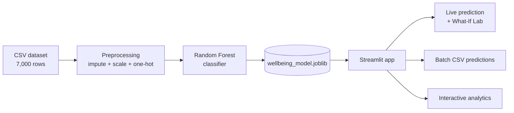

<div align="center">

# 🧠 Digital Wellbeing & Mental Health Dashboard

**An interactive Streamlit app that explores how social-media habits, sleep and psychological indicators relate to overall wellbeing, and predicts a wellbeing band (At-risk · Moderate · Good) with a machine-learning model.**

[](https://YOUR-APP-NAME.streamlit.app)


[🚀 Live Demo](https://YOUR-APP-NAME.streamlit.app) · [📓 Notebook](social_media_analysis.ipynb) · [🐞 Report a bug](../../issues)

</div>

---

## 📑 Table of Contents
- [About](#-about)
- [Features](#-features)
- [How it works](#-how-it-works)
- [Dataset](#-dataset)
- [Model results](#-model-results)
- [Run locally](#-run-locally)
- [Deploy on Streamlit Community Cloud](#-deploy-on-streamlit-community-cloud)
- [Project structure](#-project-structure)
- [Troubleshooting](#-troubleshooting)
- [Limitations](#%EF%B8%8F-limitations--honest-notes)

## 📌 About
Screen time, notifications, night-time phone use, sleep, anxiety, low mood, loneliness, FOMO and self-esteem all show up in conversations about digital wellbeing, but how do they fit together?

This project trains a **scikit-learn Random Forest pipeline** on a 7,000-person survey-style dataset and wraps it in a **Streamlit dashboard** where anyone can:

- enter a profile and instantly see the predicted wellbeing band,
- change one input at a time and watch the probabilities move,
- slice and explore the dataset with interactive Plotly charts,
- score a whole CSV of participants in one go.

> **Educational project only.** It uses a synthetic dataset and is not a medical or diagnostic tool.

## ✨ Features

| Tab | What you get |
|---|---|
| 🔮 **Live Prediction** | Predictions update **live** as you move the sidebar controls (no submit button). Confidence gauge, probability chart, radar chart comparing you with each band's average, comparison with the dataset, plain-language observations and a downloadable assessment. |
| 🧪 **What-If Lab** | Pick any input and see predicted probabilities across its whole range (line chart for numbers, grouped bars for categories), plus a **two-input heatmap** showing where you sit on the risk surface. |
| 📊 **Data Explorer** | Global filters (band, region, occupation, platform, age) drive every chart: overview donut + sunburst drill-down, scatter / scatter-matrix / parallel-coordinates, habits & sleep views, correlation explorer, a **custom chart builder** and a filterable data table. |
| 🧬 **Model Insights** | Feature importances, the anxiety × low-mood separation plot with your position marked, per-band average profiles and an honest note on what the model really learned. |
| 📁 **Batch Processing** | Download a CSV template, upload your own file (or try 200 random rows), validate columns, get predictions and probabilities, filter and download the results. |

**Sidebar shortcuts:** one-click *Healthy*, *Average* and *High-strain* profiles, and a *random person from the dataset* button.

<details>
<summary><b>👉 Input fields (23 features)</b></summary>

- **Demographics & platform:** age, gender, occupation, region, most-used platform, primary purpose
- **Digital habits & sleep:** daily screen hours, platforms used, notifications/day, minutes to first phone check, night-time use, sleep hours, physical-activity days
- **Psychological indicators:** anxiety (0-27), low mood (0-27), life satisfaction, loneliness, self-esteem, FOMO, social comparison (1-10), screen-time limits, digital-detox attempts, mental-health support-seeking
</details>

## ⚙️ How it works


## 📊 Dataset
`social_media_screentime_mental_health_2026.csv`: **7,000 participants × 25 columns** (23 features + `participant_id` + target `wellbeing_band`).

| Band | Count |
|---|---|
| Moderate | 3,766 |
| Good | 2,260 |
| At-risk | 974 |

Missing values (gender, sleep hours) are handled by imputers inside the pipeline.

## 🏆 Model results
Evaluated on a 20% hold-out set (1,400 rows):

| Model | Accuracy |
|---|---|
| Decision Tree | 100% |
| **Random Forest (deployed)** | **99.79%** |
| XGBoost | 100% |

<details>
<summary><b>Why is accuracy so high?</b></summary>

The `wellbeing_band` label in this dataset is almost entirely determined by the **anxiety** and **low-mood** scores (a depth-3 tree on those two columns reproduces the label perfectly). The near-perfect scores therefore reflect how the label was constructed, not real-world predictive power. See [Limitations](#%EF%B8%8F-limitations--honest-notes).
</details>

## 💻 Run locally
```bash
git clone https://github.com/YOUR-USERNAME/YOUR-REPO.git
cd YOUR-REPO
python -m venv .venv && source .venv/bin/activate   # Windows: .venv\Scripts\activate
pip install -r requirements.txt
streamlit run app.py
```
Open http://localhost:8501.

## 🌐 Deploy on Streamlit Community Cloud

**Before you push, check this list:**

- [ ] `app.py`, `requirements.txt`, both `.joblib` files and the CSV are in the **repo root** (the app loads them relative to `app.py`).
- [ ] The ignore file is named **`.gitignore`** (with the leading dot).
- [ ] `requirements.txt` pins `scikit-learn==1.9.0`, the version the model was trained with.
- [ ] The repo is **public** (or you have granted Streamlit access to your private repo).
- [ ] No passwords or API keys are committed. This app does not need any secrets.
- [ ] Each file is well under GitHub's 100 MB limit (the model is about 10 MB).

**Deploy steps:**

1. Create a GitHub repository and push the project:
   ```bash
   git init
   git add .
   git commit -m "Initial commit"
   git branch -M main
   git remote add origin https://github.com/YOUR-USERNAME/YOUR-REPO.git
   git push -u origin main
   ```
2. Go to [share.streamlit.io](https://share.streamlit.io) and sign in with GitHub.
3. Click **Create app** → *Deploy a public app from GitHub*.
4. Choose your repository, branch `main`, and main file path `app.py`.
5. Open **Advanced settings** and select **Python 3.12**.
6. Click **Deploy**. The first build installs the requirements and takes a few minutes.
7. Copy your `https://<your-app>.streamlit.app` URL and paste it into the two `YOUR-APP-NAME` links at the top of this README.

**After deployment:**

- Every `git push` to the branch **redeploys automatically**.
- Free apps go to sleep after a period of inactivity. Visitors can wake them with one click.
- Use **Manage app** (bottom-right of your live app) to view logs, reboot or delete the app.

> ⚠️ If you ever retrain the model with a different scikit-learn version, update the pin in `requirements.txt` to match, otherwise the model may fail to load or behave differently.

## 🗂️ Project structure
```
├── app.py                                          # Streamlit dashboard
├── wellbeing_model.joblib                          # Trained Random Forest pipeline
├── label_encoder.joblib                            # Class label encoder
├── social_media_screentime_mental_health_2026.csv  # Dataset
├── social_media_analysis.ipynb                     # EDA + model training notebook
├── requirements.txt                                # Python dependencies
├── .streamlit/config.toml                          # Theme & server settings
├── .gitignore
├── LICENSE
└── README.md
```

## 🛠️ Troubleshooting

| Problem | Fix |
|---|---|
| `ModuleNotFoundError` on deploy | Add the missing package to `requirements.txt` and push. |
| Model fails to load / `InconsistentVersionWarning` | Make sure the scikit-learn version in `requirements.txt` matches the one used for training (`1.9.0`). |
| "Model files were not found" | Check that both `.joblib` files are committed in the repo root and are not ignored by `.gitignore`. |
| Dataset tab shows a warning | Confirm the CSV filename matches exactly (it is case-sensitive on Linux). |
| Charts look empty | Widen the filters in the **Data Explorer** tab. |
| Batch upload error | Download the CSV template and compare column names. All 23 feature columns are required. |

## ⚠️ Limitations & honest notes
- **Not a medical tool.** It must not be used to diagnose or screen real people. If you or someone you know is struggling, please contact a qualified professional or local helpline.
- The dataset appears synthetic, and the target label is derived from anxiety/low-mood thresholds, so the model mostly re-learns that rule.
- Social-media variables (screen time, platform, etc.) contribute little to the prediction here. Do not read the results as causal.
- The What-If Lab shows how *this model* responds to changes, not what would happen to a real person.

## 🤝 Contributing
Issues and pull requests are welcome.

## 📄 License
MIT. See [LICENSE](LICENSE).
